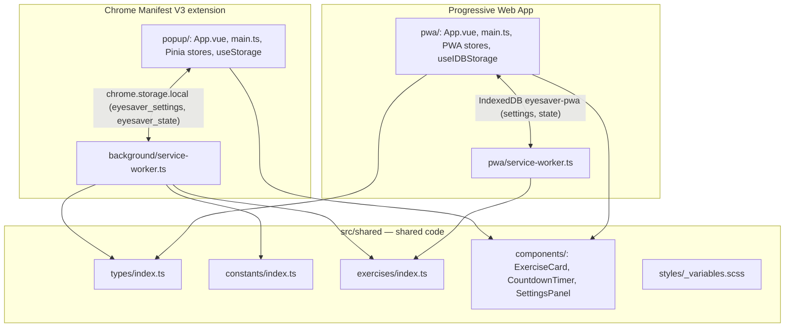

# Architecture overview

## The one-sentence version

One shared Vue/TypeScript layer feeds two independent runtime targets — a Chrome
extension and a PWA — that share UI components and exercise content but have fully
isolated storage and scheduling engines.

## Tech stack

| Layer | Technology | Where it is configured |
|-------|------------|------------------------|
| UI framework | Vue 3 (`<script setup lang="ts">` SFCs) | `src/popup/`, `src/pwa/`, `src/shared/components/` |
| Language | TypeScript, strict mode | `tsconfig.json` |
| State management | Pinia, setup-style stores | `src/popup/stores/`, `src/pwa/stores/` |
| Component library | Vuetify 3, auto-imported | `src/popup/main.ts`, `src/pwa/main.ts`, both Vite configs |
| Styling | SCSS design tokens and global styles | `src/shared/styles/_variables.scss`, `src/popup/styles/_variables.scss` (tokens); `src/popup/styles/main.scss`, `src/pwa/styles/main.scss` (global styles) |
| Build tool | Vite 5 | `vite.config.ts`, `vite.config.pwa.ts` |
| Extension bundling | `vite-plugin-web-extension` | `vite.config.ts` |
| PWA / service worker | `vite-plugin-pwa` (injectManifest strategy) + Workbox precaching | `vite.config.pwa.ts`, `src/pwa/service-worker.ts` |
| Testing | Vitest + jsdom + `@vue/test-utils` | `vitest.config.ts`, `src/popup/components/__tests__/` |

## High-level diagram

> Shared-component coupling note: `ExerciseCard.vue` is used by both targets.
> `CountdownTimer.vue` and `SettingsPanel.vue` import Pinia stores through the
> `@popup` alias, so they currently work only inside the extension popup. The PWA
> implements its own countdown and settings form inline in `src/pwa/App.vue`.

## Runtime targets

### 1. Chrome extension (`src/popup/` + `src/background/`)

The extension is a standard Manifest V3 extension:

- **Popup UI** — the Vue app in `src/popup/`. It renders the current exercise, a live
  countdown, and a settings panel, and keeps its state in Pinia stores backed by
  `chrome.storage.local`.
- **Background service worker** — `src/background/service-worker.ts`. It owns the
  reminder lifecycle: `chrome.alarms` scheduling, `chrome.notifications` display,
  snooze/dismiss handling, and reactions to settings changes.

The popup and service worker never call each other directly. They coordinate entirely
through `chrome.storage.local` (writes from one context are observed by the other via
`chrome.storage.onChanged`).

### 2. Progressive Web App (`src/pwa/`)

The PWA is a separate Vue app built from `src/pwa/index.html`:

- **App window** — `src/pwa/App.vue` plus PWA Pinia stores. It handles permission
  requests, foreground timers, settings, and the exercise card.
- **PWA service worker** — `src/pwa/service-worker.ts`. It precaches built assets
  (Workbox), listens for Periodic Background Sync and notification-click events, and
  reads/writes IndexedDB.

The PWA page and its service worker coordinate only through IndexedDB
(`eyesaver-pwa`). There is no shared state between the extension and the PWA.

## Module responsibilities

| Path | Responsibility |
|------|----------------|
| `src/shared/types/` | TypeScript interfaces shared by both targets (`Exercise`, `UserSettings`, `ReminderState`, `StorageSchema`) |
| `src/shared/constants/` | Alarm names, notification ID, storage keys, default settings/state, validation bounds |
| `src/shared/exercises/` | The static `EXERCISES` catalogue used by both targets |
| `src/shared/components/` | Shared Vue components (`ExerciseCard`, `CountdownTimer`, `SettingsPanel`) |
| `src/shared/styles/` | SCSS design tokens (brand colours, spacing, radius, typography) |
| `src/popup/` | Extension popup UI, popup Pinia stores, and the `useStorage` storage bridge |
| `src/background/` | Extension service worker (alarm/notification lifecycle) |
| `src/pwa/` | PWA Vue app, PWA Pinia stores, IndexedDB composable, and PWA service worker |
| `vite.config.ts` | Extension build config (aliases, Vuetify auto-import, web-extension bundling) |
| `vite.config.pwa.ts` | PWA build config (base path, VitePWA/injectManifest, PWA root) |
| `vitest.config.ts` | Test config (jsdom environment, aliases) |

## Storage isolation

- The extension reads and writes `chrome.storage.local` under the extension's own
  origin. Keys: `eyesaver_settings` and `eyesaver_state`.
- The PWA reads and writes an IndexedDB database named `eyesaver-pwa` under the web
  origin where it is served.

These are completely separate namespaces. Nothing is shared, migrated, or synchronised
between the extension and the PWA.

See [Data model](data-model.md) for the exact shapes and [Key flows](key-flows.md) for
how each target uses its storage.
