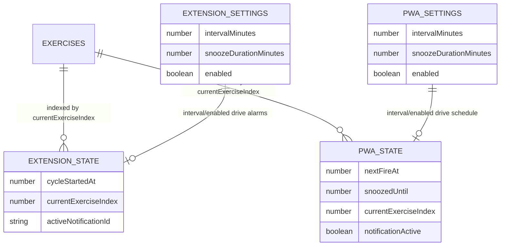

# Data model

EyeSaver has **two independent storage engines**, one per runtime target:

- The **Chrome extension** stores everything in `chrome.storage.local` under two keys.
- The **PWA** stores everything in an IndexedDB database named `eyesaver-pwa`.

Exercise content itself is static TypeScript data shared by both targets and is never
persisted at runtime.

## Shared types

All shared TypeScript interfaces are defined in `src/shared/types/index.ts`.

### `Exercise`

Defined in `src/shared/types/index.ts` (lines 6–17). Each exercise:

| Field | Type | Meaning |
|-------|------|---------|
| `index` | `number` | Zero-based index; determines sequential rotation order |
| `name` | `string` | Short display name shown in the notification and card |
| `description` | `string` | One-sentence description shown below the name |
| `steps` | `string[]` | Ordered step-by-step instructions |
| `durationSeconds` | `number` | Approximate total duration in seconds |

### `UserSettings`

Defined in `src/shared/types/index.ts` (lines 19–26):

| Field | Type | Range | Default |
|-------|------|-------|---------|
| `intervalMinutes` | `number` | 15–90 | 20 |
| `snoozeDurationMinutes` | `number` | 2–15 | 5 |
| `enabled` | `boolean` | — | `true` |

Defaults are in `DEFAULT_SETTINGS` (`src/shared/constants/index.ts` lines 10–14); the
bounds are `INTERVAL_MIN_MINUTES`, `INTERVAL_MAX_MINUTES`, `SNOOZE_MIN_MINUTES`, and
`SNOOZE_MAX_MINUTES` (lines 23–26 of the same file).

### `ReminderState` (extension)

Defined in `src/shared/types/index.ts` (lines 28–39):

| Field | Type | Meaning |
|-------|------|---------|
| `cycleStartedAt` | `number` | Unix ms timestamp when the current reminder cycle started |
| `currentExerciseIndex` | `number` | Index of the **next** exercise to be shown (pre-advanced by the alarm handler) |
| `activeNotificationId` | `string \| null` | ID of the active reminder notification, or `null` when none is visible |

Defaults are in `DEFAULT_STATE` (`src/shared/constants/index.ts` lines 16–20).

## Extension storage (`chrome.storage.local`)

Storage keys are declared in `src/shared/constants/index.ts` (lines 7–8):

| Key | Shape | Written by | Read by |
|-----|-------|-----------|---------|
| `eyesaver_settings` | `UserSettings` | Popup (`useSettingsStore`) | Popup stores + service worker |
| `eyesaver_state` | `ReminderState` | Popup (`App.vue`, `useExerciseStore`) + service worker | Popup stores + service worker |

The popup reads and writes these keys through `src/popup/composables/useStorage.ts`,
which keeps a reactive Vue ref synchronised with `chrome.storage.onChanged` events. The
service worker uses its own small helpers at the top of
`src/background/service-worker.ts` (`getSettings`, `getState`, `setState`).

### Extension state invariant: the pre-advanced index

The service worker **pre-advances** `currentExerciseIndex` when a main reminder fires
(`src/background/service-worker.ts` lines 134–143). At that moment:

1. The stored value N is read.
2. The notification for exercise N is shown.
3. The stored value is immediately updated to `(N + 1) % 6`.

So `currentExerciseIndex` always means "the index that will be used for the upcoming
notification". This is why snooze and dismiss flows do **not** advance the index again;
snooze re-derives the currently shown exercise as `(storedIndex - 1 + 6) % 6`
(service worker lines 161–163).

## Exercises catalogue

The six bundled exercises are defined in `src/shared/exercises/index.ts` (lines 3–72):

| Index | Name | Duration |
|-------|------|----------|
| 0 | 20-20-20 Rule | 20s |
| 1 | Palming | 60s |
| 2 | Conscious Blinking | 30s |
| 3 | Figure-Eight Tracking | 45s |
| 4 | Near-Far Focus Shift | 40s |
| 5 | Eye Rolling | 30s |

The catalogue is read-only at runtime. It is used by:

- the extension service worker to choose the notification content,
- the extension popup stores/components to render the current exercise,
- the PWA `App.vue` and `service-worker.ts` for the same purposes.

## PWA storage (IndexedDB)

The PWA database schema is implemented twice and must be kept in sync:

- `src/pwa/composables/useIDBStorage.ts` (used by the PWA window),
- `src/pwa/service-worker.ts` lines 13–56 (duplicated helpers, because the service
  worker cannot import the Vue composable).

### Database and object stores

| Property | Value |
|----------|-------|
| Database name | `eyesaver-pwa` |
| Version | `1` |
| Object stores | `settings`, `state` |
| Store key path | `key` (string) |
| Record shape | `{ key: string, value: any }` |

Both stores are flat key-value stores, mirroring the shape of `chrome.storage.local`
from the extension.

### `settings` store records

| Record key | Value type | Default | Validation |
|-----------|-----------|---------|------------|
| `intervalMinutes` | `number` | `20` | integer, 15–90 |
| `snoozeDurationMinutes` | `number` | `5` | integer, 2–15 |
| `enabled` | `boolean` | `true` | — |

Written by `src/pwa/stores/settingsStore.ts`; read by the PWA window and service worker.

### `state` store records

| Record key | Value type | Default | Notes |
|-----------|-----------|---------|-------|
| `nextFireAt` | `number \| null` | `null` | Unix ms of the next scheduled fire; `null` = not yet scheduled |
| `snoozedUntil` | `number \| null` | `null` | Unix ms until which reminders are snoozed |
| `currentExerciseIndex` | `number` | `0` | Index into the shared exercises array |
| `notificationActive` | `boolean` | `false` | `true` while a notification is visible |

Written by `src/pwa/stores/scheduleStore.ts` (window) and `src/pwa/service-worker.ts`
(background). The window store persists one key at a time through `setItem`; the service
worker also writes one key at a time through `idbPut`. See "Gotchas" below.

### PWA scheduling invariants

1. At most one `nextFireAt` is active at any time.
2. `currentExerciseIndex` is incremented **when the notification fires**, not when it
   is dismissed.
3. While `snoozedUntil` is in the future, it takes precedence over `nextFireAt`; no new
   notification fires.
4. All timestamps are Unix milliseconds from `Date.now()`.
5. When `enabled === false`, the service worker returns without firing; pending
   schedule state is left in place (paused, not deleted).

## Relationships

> The diagram groups extension and PWA entities for readability; the two groups never
> reference each other at runtime. Extension entities live in `chrome.storage.local`
> under `eyesaver_settings`/`eyesaver_state`; PWA entities live in the `settings`/`state`
> IndexedDB stores.

## Gotchas

- **Extension vs PWA isolation** — no data is shared between the two targets.
- **Non-atomic PWA multi-key writes** — `recordFired()` and the service worker's
  `checkAndFire()` update several `state` keys with separate `setItem`/`idbPut` calls
  rather than one IndexedDB transaction. If a write is interrupted, state can be
  inconsistent until the next flow corrects it.
- **Duplicated IndexedDB helpers** — the schema (database name, version, store names,
  key path) appears in both `useIDBStorage.ts` and `service-worker.ts`. Change both
  together and bump `DB_VERSION` for schema changes.
- **Settings defaults/bounds in the PWA** — the PWA store refs start at `20`, `5`, and
  `true` (`src/pwa/stores/settingsStore.ts` lines 12–14) and its service worker
  fallbacks use `20` and `5` (`src/pwa/service-worker.ts` lines 79 and 168). Keep these
  in sync with the shared constants when changing defaults.
