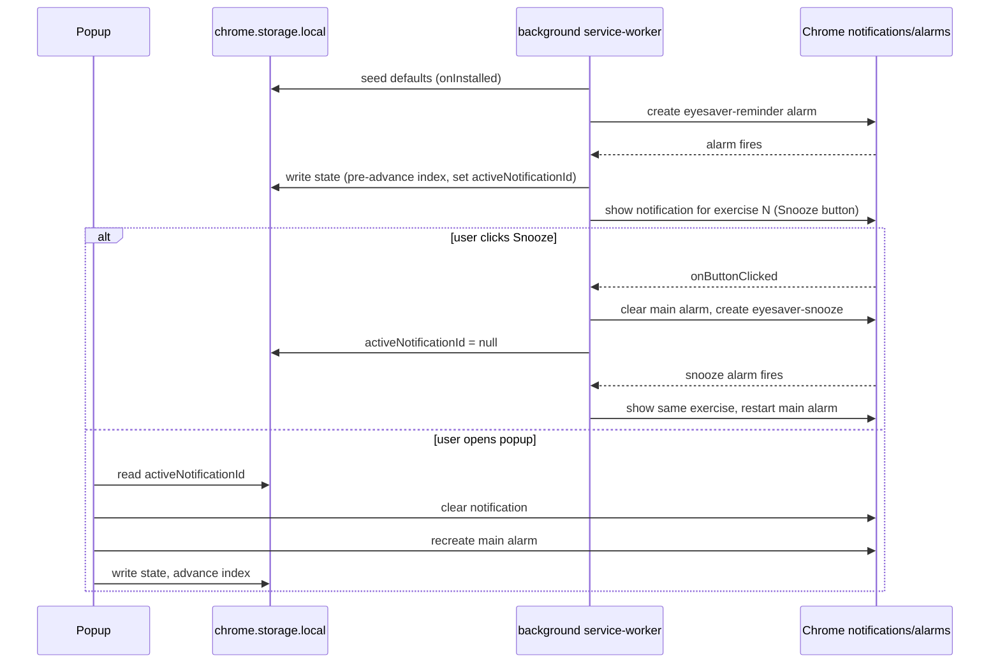

# Key flows

This page describes the main user and system flows for both targets, with file and line
references. Line numbers are from the current source and may drift slightly as code
changes.

## Chrome extension flows

All extension flows live in `src/background/service-worker.ts` (scheduling and
notifications) and `src/popup/` (UI). The popup and service worker coordinate only
through `chrome.storage.local`.

### 1. Install / first-run seed

File: `src/background/service-worker.ts` lines 96–121.

1. Chrome fires `chrome.runtime.onInstalled`.
2. The worker reads `eyesaver_settings` and `eyesaver_state`, falling back to
   `DEFAULT_SETTINGS` and a `DEFAULT_STATE` whose `cycleStartedAt` is `Date.now()`.
3. It writes both keys back to `chrome.storage.local`.
4. If `settings.enabled` is true, it clears and recreates the `eyesaver-reminder`
   alarm with `delayInMinutes = intervalMinutes`.

### 2. Main reminder alarm fires

File: `src/background/service-worker.ts` lines 125–152 (the `ALARM_NAME` branch).

1. The `eyesaver-reminder` alarm fires.
2. The worker reads settings and state; if reminders are disabled, it returns.
3. It reads the current index `N = state.currentExerciseIndex`.
4. It computes `nextIndex = (N + 1) % EXERCISES.length`.
5. It writes `eyesaver_state` with `currentExerciseIndex = nextIndex`,
   `activeNotificationId = 'eyesaver-active'`, and `cycleStartedAt = Date.now()`.
   This is the **pre-advance**: the stored index now points at the *next* exercise.
6. It shows a notification for exercise `N` (see `showExerciseNotification`, lines
   75–92), with a single **Snooze** button.
7. It schedules the next `eyesaver-reminder` alarm in `intervalMinutes`.

### 3. Snooze button clicked

File: `src/background/service-worker.ts` lines 177–189.

1. The user clicks **Snooze** (button index 0) on notification `eyesaver-active`.
2. The worker clears the main `eyesaver-reminder` alarm.
3. It creates the `eyesaver-snooze` alarm with `delayInMinutes = snoozeDurationMinutes`.
4. It clears the visible notification and sets `activeNotificationId = null`.

### 4. Snooze alarm fires (re-show the same exercise)

File: `src/background/service-worker.ts` lines 154–172 (the `SNOOZE_ALARM_NAME` branch).

1. The `eyesaver-snooze` alarm fires.
2. The worker reads settings and state; if disabled, it returns.
3. Because the main alarm already pre-advanced the stored index from N to N+1, the
   snoozed exercise is derived as `(storedIndex - 1 + total) % total`.
4. It sets `activeNotificationId = 'eyesaver-active'` and shows that same exercise.
5. It restarts the main `eyesaver-reminder` alarm for a fresh full interval.

### 5. User dismisses the notification

File: `src/background/service-worker.ts` lines 193–211.

1. Chrome fires `chrome.notifications.onClosed` with `byUser = true`.
2. The worker sets `activeNotificationId = null` and `cycleStartedAt = Date.now()`.
   It does **not** advance the index (the main alarm handler already did).
3. It clears and recreates the main `eyesaver-reminder` alarm for a fresh interval.

### 6. Popup open while a notification is active (acknowledgment)

File: `src/popup/App.vue` lines 22–47 (`onMounted`).

1. The popup waits for `exerciseStore.ready` and `scheduleStore.ready`.
2. It checks notification permission level to show a warning if denied.
3. If `scheduleStore.activeNotificationId` is not null, the popup:
   - clears notification `eyesaver-active`,
   - clears and recreates the main alarm,
   - writes a new `eyesaver_state` with `activeNotificationId = null` and
     `cycleStartedAt = Date.now()`,
   - calls `exerciseStore.advance()` to move the displayed index forward one step.

### 7. Settings changed from the popup

Files: `src/popup/stores/settingsStore.ts` (write) and
`src/background/service-worker.ts` lines 215–252 (reaction).

1. The user edits the settings form (`SettingsPanel.vue`) and saves.
2. `useSettingsStore.saveSettings` clamps the values and writes `eyesaver_settings`
   via `useStorage`.
3. The service worker's `chrome.storage.onChanged` listener sees the settings key:
   - **enabled → disabled**: clears all alarms and the notification, sets
     `activeNotificationId = null`.
   - **disabled → enabled**: starts a fresh main alarm and resets `cycleStartedAt`.
   - **interval changed while enabled**: recreates the main alarm with the new delay
     and resets `cycleStartedAt`.

## PWA flows

The PWA window logic is in `src/pwa/App.vue`; the persistent schedule logic is in
`src/pwa/stores/scheduleStore.ts` and the service worker in `src/pwa/service-worker.ts`.
The two sides coordinate only through IndexedDB.

### 1. App startup and permission request

Files: `src/pwa/App.vue` lines 111–180 (`initApp`) and 182–201 (`requestPermission`).

1. `onMounted` calls `initApp()`.
2. The settings and schedule stores hydrate from IndexedDB.
3. `initApp` reads `Notification.permission`, detects standalone display mode, and
   detects Periodic Background Sync support from the service worker registration.
4. If the URL contains `?exercise=N`, the current exercise index is set to `N`.
5. If permission is `granted`, it initialises the schedule and starts the foreground
   timer; if Periodic Sync is available it registers the `eyesaver-reminder` tag.
6. It also resumes an active snooze timer and fires immediately if a reminder is
   overdue.
7. `requestPermission()` is triggered by the permission banner; on `granted` it starts
   the same schedule/timer/sync setup.

### 2. Foreground timer fires a reminder

Files: `src/pwa/App.vue` lines 69–109 and `src/pwa/stores/scheduleStore.ts` lines
41–50.

1. `startForegroundTimer()` computes the delay until `scheduleStore.nextFireAt` and
   starts a 1-second tick timer for the progress bar.
2. When the timeout elapses, `fireReminder()` runs:
   - asks the service worker to `showNotification` for the current exercise,
   - attaches `snooze`/`dismiss` actions and `data.exerciseIndex`,
   - calls `scheduleStore.recordFired()` (increments the index, sets
     `notificationActive = true`, clears `snoozedUntil`),
   - calls `scheduleStore.initSchedule(intervalMs)` to set the next fire time,
   - restarts the foreground timer.

### 3. Background wake-up (Periodic Background Sync / activate)

File: `src/pwa/service-worker.ts` lines 75–116 (`checkAndFire`); registered in
`periodicsync` (lines 132–136) and `activate` (lines 139–154).

1. The service worker wakes on a `periodicsync` event with tag `eyesaver-reminder`, or
   on `activate`.
2. `checkAndFire()` reads `settings.enabled`, the interval, and the four `state` keys.
3. If disabled, it returns.
4. If a snooze is still in the future, it returns.
5. If a snooze has elapsed, it shows the current exercise, increments the index, and
   writes new `nextFireAt`, `notificationActive = true`, `snoozedUntil = null`.
6. If `nextFireAt` is overdue, it does the same fire-and-advance sequence.
7. If no schedule exists, it initialises `nextFireAt` without showing a notification.

### 4. Notification click (snooze / dismiss / open)

File: `src/pwa/service-worker.ts` lines 157–199.

1. `notificationclick` fires; the notification is closed immediately.
2. If the action is `snooze`: write `snoozedUntil = now + snoozeDurationMinutes`,
   clear `notificationActive`.
3. If the action is `dismiss`: write `nextFireAt = now + intervalMinutes`, clear
   `notificationActive` and `snoozedUntil`.
4. Default click (no action): open/focus a window at `/?exercise=N` so the app shows
   the exercise that was just notified.

### 5. Settings save

Files: `src/pwa/App.vue` lines 203–231 (`onSettingsSave`) and
`src/pwa/stores/settingsStore.ts`.

1. The user saves the inline settings form in `App.vue`.
2. `onSettingsSave` writes the three settings through the PWA settings store (which
   validates interval and snooze bounds).
3. It recalculates the schedule with `recordIntervalChange`, restarts the foreground
   timer, and re-registers Periodic Sync with the new interval when applicable.

### 6. Enable/disable toggle

File: `src/pwa/App.vue` lines 233–268 (watcher on `settingsStore.enabled`).

1. When `enabled` becomes false: clear the foreground timer and unregister Periodic
   Sync.
2. When `enabled` becomes true: re-initialise the schedule, restart the foreground
   timer, and re-register Periodic Sync if permission is granted.

### 7. Service worker update prompt

File: `src/pwa/App.vue` lines 32–38.

1. `useRegisterSW()` (from `virtual:pwa-register/vue`) exposes `needRefresh` and
   `updateServiceWorker`.
2. When a new service worker is waiting, `App.vue` shows an update banner.
3. Clicking **Update now** calls `updateServiceWorker(true)` and reloads the page.

## Sequence diagram (extension, simplified)

## Snooze exercise-index difference between targets

The two targets handle snooze differently, and only the extension re-shows the snoozed
exercise:

- **Extension** — the main alarm pre-advances the stored index *before* showing the
  notification. The snooze alarm therefore reconstructs the snoozed exercise as
  `(storedIndex - 1 + total) % total` and re-shows that same exercise.
- **PWA** — the stored index is advanced right after the notification is shown, in
  both the foreground and background paths. `fireReminder()` calls
  `scheduleStore.recordFired()` immediately after `showNotification` resolves
  (`src/pwa/App.vue` lines 96–105), and `checkAndFire()` writes
  `currentExerciseIndex + 1` right after `showReminder` (`src/pwa/service-worker.ts`
  lines 90–108). The `notificationclick` snooze branch only writes `snoozedUntil` and
  `notificationActive = false` (`src/pwa/service-worker.ts` lines 165–170); it does
  **not** restore the index. By the time the snooze elapses, the stored index already
  points at the **next** exercise, so `checkAndFire()`/`fireReminder()` show that
  stored index. The PWA therefore does **not** re-show the snoozed exercise.

Keep this difference in mind when changing exercise rotation or snooze behaviour.
